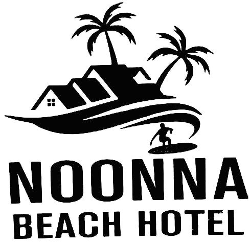
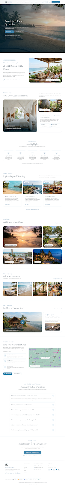
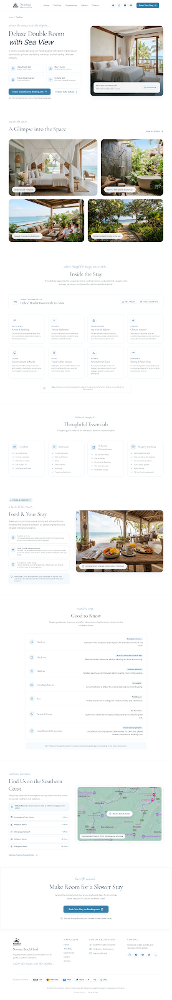
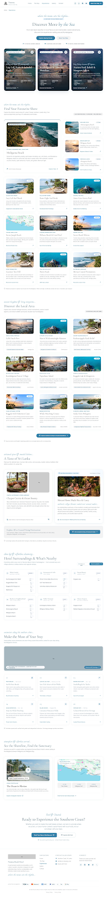
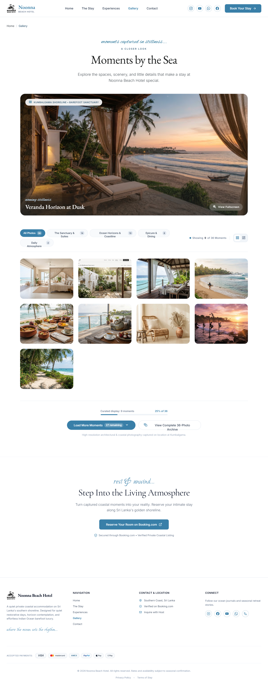
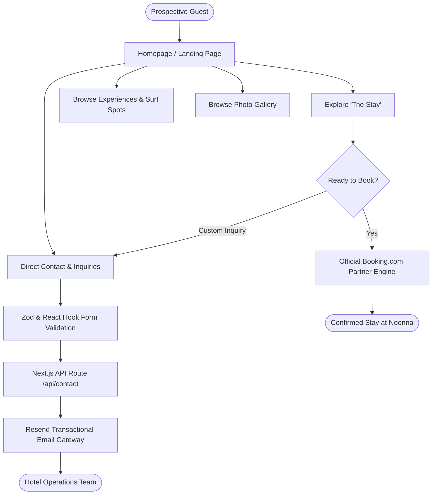
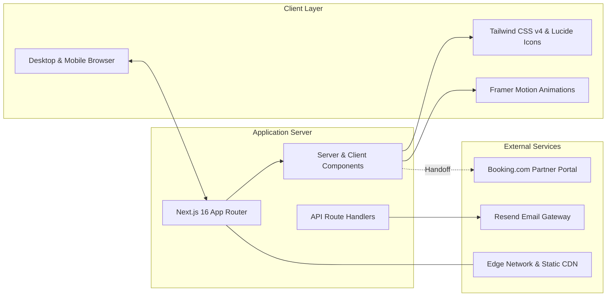

<div align="center">

  

  # 🌊 Noonna Beach Hotel & Coastal Sanctuary
  
  **A Luxury Coastal Sanctuary on Sri Lanka's Southern Shoreline**
  
  *Kumbalgama, Matara District, Southern Province, Sri Lanka*

  <p align="center">
    <a href="https://www.booking.com/hotel/lk/noonna-beach.html">
      
    </a>
    
    
    
  </p>

  <p align="center">
    <a href="#-executive-summary">Executive Summary</a> •
    <a href="#-visual-showcase">Visual Showcase</a> •
    <a href="#-system-architecture--guest-flows">Guest Flows & Architecture</a> •
    <a href="#-key-features">Key Features</a> •
    <a href="#%EF%B8%8F-technology-stack">Tech Stack</a> •
    <a href="#-getting-started">Getting Started</a> •
    <a href="#-contact--operations">Contact</a>
  </p>

  ---
</div>

## 📌 Executive Summary

**Noonna Beach Hotel** is a premium, boutique beachfront retreat nestled along the pristine southern coastline of Sri Lanka. 

This repository houses the official high-performance web platform designed to provide potential guests with a digital experience mirroring the luxury and tranquility of the physical resort. The platform blends high-definition visuals, immersive regional storytelling, streamlined reservation handoffs via Booking.com, and seamless direct inquiries via integrated transactional emails.

### 🌟 Highlights at a Glance
- 🌴 **Prime Oceanfront Location**: Kumbalgama beachside haven with direct access to southern coastal surf and heritage.
- 🛏️ **Boutique Accommodation**: Curated showcase of private Double Rooms with ocean vistas, modern comforts, and bespoke amenities.
- 🗺️ **Comprehensive Regional Guide**: 28+ southern coast destinations, surf breaks (Midigama, Mirissa, Weligama), and cultural expeditions.
- ⚡ **Modern Web Engineering**: Engineered on Next.js 16 (App Router), Tailwind CSS v4, dynamic carousels, and resilient Playwright E2E test coverage.

---

## 📸 Visual Showcase

<div align="center">
  <table>
    <tr>
      <td width="50%" align="center">
        <b>Homepage & Coastal Landing</b><br/><br/>
        
        <p><i>Immersive hero banner, welcome statement, highlights, and regional bento grid.</i></p>
      </td>
      <td width="50%" align="center">
        <b>The Stay (Accommodations)</b><br/><br/>
        
        <p><i>Room details, luxury amenities, pricing transparency, and direct booking CTA.</i></p>
      </td>
    </tr>
    <tr>
      <td width="50%" align="center">
        <b>Coastal & Cultural Experiences</b><br/><br/>
        
        <p><i>Curated guide across 28+ southern destinations, surf breaks, and lighthouses.</i></p>
      </td>
      <td width="50%" align="center">
        <b>Atmospheric Visual Gallery</b><br/><br/>
        
        <p><i>High-fidelity gallery highlighting grounds, ocean views, and resort architecture.</i></p>
      </td>
    </tr>
  </table>
</div>

---

## 🗺️ System Architecture & Guest Flows

### 1. Guest Journey Flow



### 2. High-Level Technical Architecture



---

## 💎 Key Features

| Category | Capability | Description |
|---|---|---|
| **Digital Concierge** | **The Stay Showcase** | High-resolution room showcase with dimension specs, amenities (A/C, WiFi, ocean balcony), and pricing indicators. |
| **Regional Discovery** | **28+ Destination Guides** | Deep guides covering Southern Coast beaches (Midigama, Mirissa, Weligama), Dondra Lighthouse, and safari excursions. |
| **Reservation Engine** | **Verified Partner Integration**| Seamless handoff to verified Booking.com listing ensuring immediate calendar sync and secure transactions. |
| **Inquiry Pipeline** | **Direct Guest Messaging** | Server-side validated contact form powered by **Resend** with real-time feedback via **Sonner**. |
| **Interactive UI** | **Touch-Optimized Carousels** | Responsive sliders, Bento grid layouts, lightbox gallery, and fluid mobile navigation menu. |
| **Quality Assured** | **Comprehensive QA** | Full end-to-end regression test suite orchestrated via **Playwright** across desktop and mobile viewports. |

---

## 🛠️ Technology Stack

| Domain | Technology | Purpose |
|---|---|---|
| **Core Framework** | [Next.js 16 (App Router)](https://nextjs.org/) | Hybrid Server Components, optimized image pipelines, and file-based routing. |
| **UI Library** | [React 19](https://react.dev/) | Modern concurrent UI architecture and component state handling. |
| **Styling** | [Tailwind CSS 4](https://tailwindcss.com/) | Cutting-edge utility-first CSS engine with responsive design tokens. |
| **Typography & Icons** | [Lucide React](https://lucide.dev/) | Consistent, lightweight vector iconography. |
| **Animations** | [Framer Motion](https://www.framer.com/motion/) | Smooth entrance, scroll transitions, and interactive visual polish. |
| **Form Management** | [React Hook Form](https://react-hook-form.com/) + [Zod](https://zod.dev/) | Type-safe form validation with client and server resilience. |
| **Email Delivery** | [Resend](https://resend.com/) | Robust API integration for inquiry deliveries to hotel operations. |
| **Testing & Verification** | [Playwright](https://playwright.dev/) | Comprehensive automated end-to-end cross-browser testing. |

---

## 📂 Project Directory Structure

```text
noonna-resort/
├── public/                     # Static media assets & vector icons
│   ├── images/
│   │   ├── branding/           # Hotel logos, social preview (OG) images
│   │   ├── hotel/              # Property grounds, exterior, and beach views
│   │   ├── readme/             # Curated documentation previews & badges
│   │   └── rooms/              # Suite interiors & accommodations
├── src/
│   ├── app/                    # Next.js App Router root
│   │   ├── api/contact/        # Secure Resend email API endpoint
│   │   ├── contact/            # Dedicated contact & arrival page
│   │   ├── experiences/        # Curated regional expeditions & surf guide
│   │   ├── gallery/            # Visual gallery showcasing resort atmosphere
│   │   ├── stay/               # Double room specifications & booking flow
│   │   ├── layout.tsx          # Global metadata, layout, and font configuration
│   │   └── page.tsx            # Homepage composition
│   ├── components/             # Reusable UI architecture
│   │   ├── layout/             # Header, Navigation, and Footer
│   │   ├── sections/           # Modular page blocks (Hero, Bento, FAQs, etc.)
│   │   ├── shared/             # Carousels, Accordions, and Action bars
│   │   └── ui/                 # Atomic elements (Buttons, Containers, Headings)
│   ├── data/                   # Structured static content (destinations, FAQs, guides)
│   ├── lib/                    # Constant values, hotel configuration, metadata
│   └── types/                  # Strict TypeScript interfaces
├── tests/                      # Automated Playwright test specifications
└── playwright.config.ts        # E2E test harness configuration
```

---

## 🚀 Getting Started

Follow these instructions to run the project locally for development or review.

### Prerequisites
- **Node.js**: `v18.17.0` or higher
- **Package Manager**: `npm`, `pnpm`, or `yarn`

### 1. Clone & Install
```bash
# Clone the repository
git clone https://github.com/your-username/noonna-resort.git

# Navigate into project root
cd noonna-resort

# Install dependencies
npm install
```

### 2. Configure Environment Variables
Create a `.env.local` file from the provided `.env.example`:
```bash
cp .env.example .env.local
```

Configure your credentials:
```env
# Resend API Key for sending inquiries
RESEND_API_KEY=re_your_api_key_here

# Destination address where guest inquiries are delivered
CONTACT_EMAIL=reservations@noonnabeach.com

# Verified sender address configured in Resend
RESEND_FROM_EMAIL=inquiries@noonnabeach.com
```

### 3. Run Development Server
```bash
npm run dev
```
Open [http://localhost:3000](http://localhost:3000) in your browser to inspect the resort platform.

### 4. Build for Production
```bash
# Generate optimized production build
npm run build

# Start production server
npm run start
```

### 5. Automated Testing (Playwright)
```bash
# Run comprehensive E2E test suite
npx playwright test

# View interactive HTML test report
npx playwright show-report
```

---

## 📞 Contact & Operations

- **Hotel Name:** Noonna Beach Hotel
- **Location:** Kumbalgama, Matara District, Southern Province, Sri Lanka
- **Official Booking Partner:** [Booking.com Listing](https://www.booking.com/hotel/lk/noonna-beach.html)
- **Direct Reservations:** reservations@noonnabeach.com

---

<div align="center">
  <sub>© Noonna Beach Hotel. All rights reserved. Crafted with precision for exceptional coastal hospitality.</sub>
</div>
